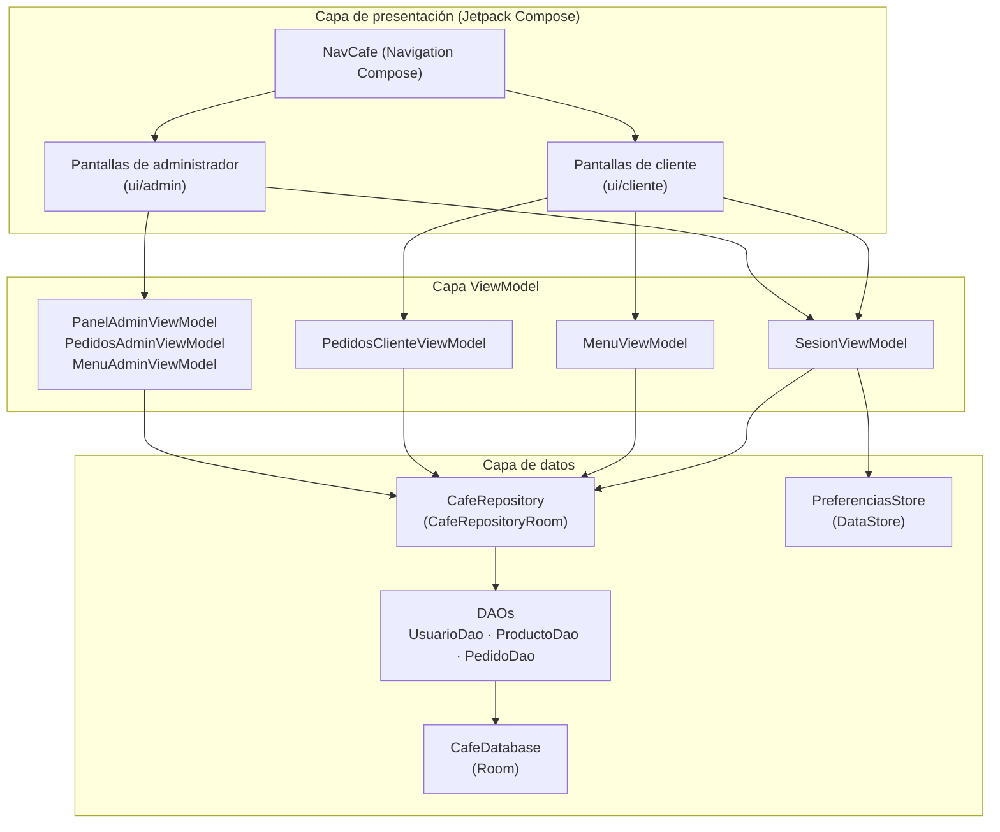
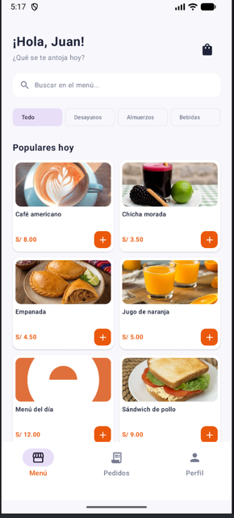
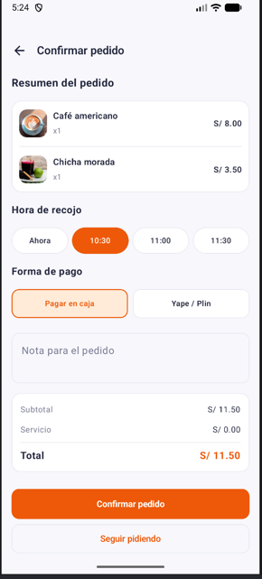
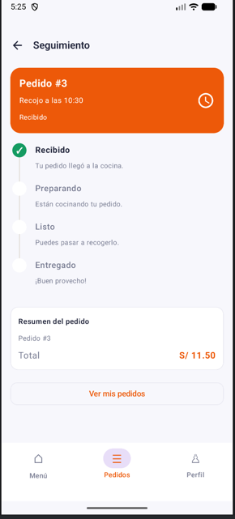
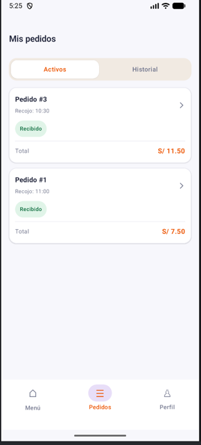
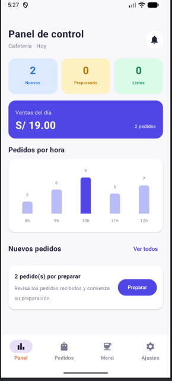
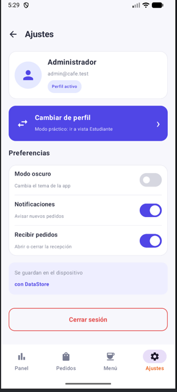

# Cafecampus

Aplicación Android para la gestión de la cafetería de un campus universitario. Permite a los **Estudiantes** explorar el menú, armar su carrito, confirmar pedidos y hacer seguimiento; y a los **Administradores** gestionar pedidos, el catálogo de productos y los ajustes de la aplicación.

## Descripción

**Cafecampus** es una app nativa de Android desarrollada con **Kotlin** y **Jetpack Compose (Material 3)** que sigue el patrón **MVVM**. La aplicación cubre el flujo completo de una cafetería de campus:

- **Estudiante (rol `CLIENTE`):**
  - Inicio de sesión con selector de rol.
  - Explorar el menú, buscar y filtrar por categoría.
  - Ver detalle de producto y agregar al carrito.
  - Confirmar pedido (hora de recojo, forma de pago y nota).
  - Seguimiento del pedido por estados (`Recibido → Preparando → Listo → Entregado`).
  - Consultar el historial de "Mis pedidos".

- **Administrador (rol `ADMIN`):**
  - Panel con ventas del día y conteo de pedidos por estado.
  - Gestión de pedidos: avanzar estado o cancelar.
  - Gestión del menú: crear, editar, eliminar productos y alternar disponibilidad.
  - Ajustes: modo oscuro, recepción de pedidos, **cambio de perfil** (alterna entre Admin y Estudiante sin volver a iniciar sesión) y **cierre de sesión**.

Ambos perfiles comparten la **misma base de datos Room**, por lo que los productos y pedidos se conservan al alternar de perfil.


## Árbol de paquetes

```
app/src/main/java/com/clemente/cafecampusclemente/
├── CafeApp.kt                      # Aplicación: inicializa Room y siembra datos
├── MainActivity.kt                 # Activity principal (setContent + tema)
│
├── ViewModel/
│   ├── SesionViewModel.kt          # Login, cambio de perfil, cierre de sesión, ajustes
│   ├── MenuViewModel.kt            # Menú y carrito (cliente)
│   ├── PedidosClienteViewModel.kt  # Pedidos del cliente (confirmar, seguir, historial)
│   ├── PanelAdminViewModel.kt      # Métricas del panel administrativo
│   ├── PedidosAdminViewModel.kt    # Gestión de pedidos por estado
│   └── MenuAdminViewModel.kt       # CRUD del catálogo de productos
│
├── data/
│   ├── local/
│   │   ├── CafeDatabase.kt         # Base de datos Room
│   │   ├── DatosIniciales.kt       # Siembra productos y usuarios demo
│   │   ├── dao/
│   │   │   ├── UsuarioDao.kt
│   │   │   ├── ProductoDao.kt
│   │   │   └── PedidoDao.kt
│   │   ├── entity/
│   │   │   ├── Usuario.kt
│   │   │   ├── Producto.kt
│   │   │   ├── Pedido.kt
│   │   │   └── DetallePedido.kt
│   │   └── relation/
│   │       └── PedidoConDetalle.kt # Pedido + detalles + cliente
│   ├── prefs/
│   │   └── PreferenciasStore.kt    # DataStore: perfil activo, modo oscuro, recibir pedidos
│   └── repository/
│       ├── CafeRepository.kt       # Contrato del repositorio
│       └── CafeRepositoryRoom.kt   # Implementación con Room
│
├── model/
│   ├── Rol.kt                      # CLIENTE / ADMIN
│   ├── EstadoPedido.kt             # Estados del pedido
│   └── ItemCarrito.kt              # Ítem del carrito
│
└── ui/
    ├── navigation/
    │   └── NavCafe.kt              # Grafo de navegación y creación de ViewModels
    ├── theme/
    │   ├── Color.kt
    │   ├── Theme.kt                # Tema claro/oscuro
    │   └── Type.kt
    ├── admin/
    │   ├── PanelScreen.kt
    │   ├── PedidosAdminScreen.kt
    │   ├── DetallePedidoAdminScreen.kt
    │   ├── MenuAdminScreen.kt
    │   ├── FormularioProductoScreen.kt
    │   ├── AjustesScreen.kt
    │   └── BarraNavegacionAdmin.kt
    └── cliente/
        ├── LoginScreen.kt          # Login con selector de rol
        ├── MenuScreen.kt
        ├── DetalleProductoScreen.kt
        ├── ConfirmarPedidoScreen.kt
        ├── SeguimientoScreen.kt
        └── MisPedidosScreen.kt
```

## Arquitectura MVVM



## Capturas del perfil del cliente







## Capturas del perfil del administrador



